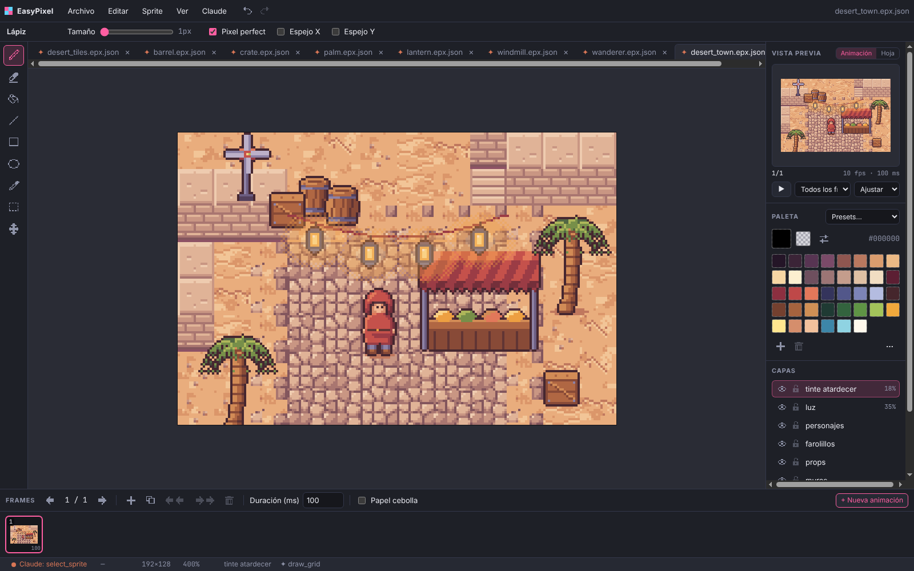
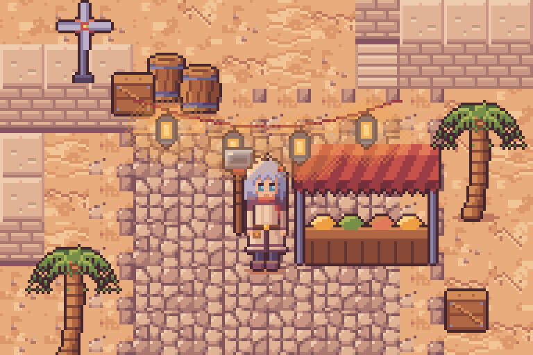
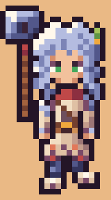
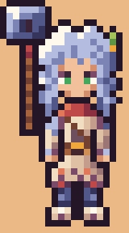
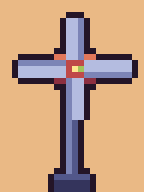
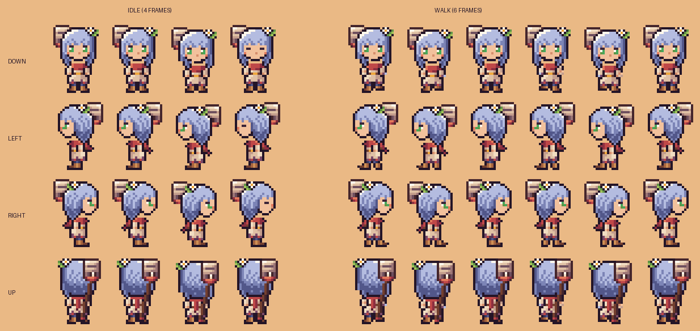
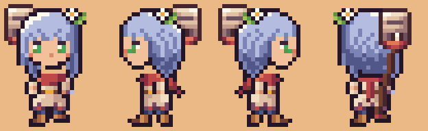
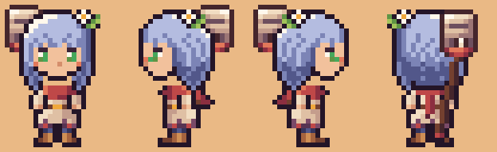
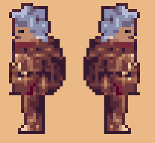

# Example: desert town

A small asset set in the style of top-down pixel art RPGs like *Soulbound*: warm sand, beige stone,
red cloth and purple shadows. It was drawn entirely through the MCP tools (`create_sprite`,
`add_layer`, `update_layer`, `draw_grid`, `add_frame`, `create_animation`,
`save_sprite`), the way Claude would do it.

  
  
  
  

| File | Contents |
|---|---|
| `desert_tiles.epx.json` | 64×64 tileset of 16×16 tiles: sand (plain, cracked, dunes, pebbles), cobblestone, cobble fading into sand, flagstones, wall top, wall face, wall base, stairs, dry bush, grass, rocks |
| `barrel.epx.json`, `crate.epx.json` | 16×20 barrel and 16×16 crate |
| `palm.epx.json` | 40×52 palm tree with its ground shadow |
| `lantern.epx.json` | 10×15 hanging lantern, `flicker` animation (2 frames) |
| `windmill.epx.json` | 24×32 windmill, `spin` animation (4 frames) |
| `adventurer.epx.json` | 20×40 canvas, ~14×32 slim adventurer with spiky silver hair (hand-pixelled: 6 px face with 2×1 px eyes under a lash line, a scarf with a loose end, a warm-steel hammer resting against the left shoulder). 24 frames, 8 animations for the four directions: `idle_down`/`walk_down`, `idle_up`/`walk_up`, `idle_right`/`walk_right` and `idle_left`/`walk_left` (the right view mirrored). The hair tips, the scarf end and the free right arm swing while walking |
| `chibi.epx.json` | 24×32 chibi take on the same adventurer: big head with full bangs, 2×3 eyes with a highlight, a flower clip, big red scarf, hammer on her back. 40 frames: `idle_*` (4 frames, with a blink) and `walk_*` (6 frames) for `down`, `left`, `right` and `up` (left mirrors right) |
| `painterly.epx.json` | 24×48 painterly take: realistic proportions, 3/4 view walking down-right, clustered shading lit from the upper right and no uniform black outline. Its own palette adds 18 colours (browns, reds and a silver lavender) after the shared 39. `idle_right`/`walk_right` (2 and 6 frames) and the mirrored `idle_left`/`walk_left` |
| `desert_town.epx.json` | 192×128 scene built from the pieces above, one layer per depth: `suelo`, `muros`, `props`, `farolillos`, `personajes` |
| `*.png`, `*.gif` | Spritesheets and previews |

## Chibi version

  
  

## Painterly version

  
  

## Palette

39 colors in ramps, all of them in every file:

| Ramp | Colors |
|---|---|
| Outlines and purple shadows | `241527` `3b2437` `573452` `7a4a68` |
| Sand | `8f5650` `b9785f` `d99c6e` `ebb985` `f6d6a4` `fcefd0` |
| Stone | `6e4f5e` `9c7575` `c49d8c` `dfc0a4` `f1ddc2` |
| Red cloth | `5c1f33` `8c2f40` `bf4848` `e2785a` |
| Metal | `34345c` `52578a` `7c84b6` `b4bce0` |
| Wood | `45262c` `74402f` `a5633e` `cf8f55` |
| Green | `1f3a33` `33633e` `5f9445` `a3c35a` |
| Lamp, skin, accents | `f0a83c` `ffe58f` `d58e6c` `f2c19c` `3d86a8` `8fd3e2` `fff8ec` `46a85c` (eyes) |

Outlines use the darkest color of each ramp instead of black, and shadows lean purple rather than
grey. That is most of what gives the style its warmth.

## Lighting

In the reference game most of the mood (sunset glow, night blues, lamp bloom) comes from the
engine. To preview it inside the editor, the scene has two extra layers:

- `luz` (35% opacity): dithered warm halos around the lanterns.
- `tinte atardecer` (18% opacity): a flat orange layer over everything.

Hide them to get the neutral daylight colors. In Godot, use `CanvasModulate`, `PointLight2D` and a
`WorldEnvironment` with glow instead, so the same sprites work by day and by night.
