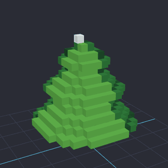

# Example: voxel pine (sprite stacking)

Generated by EasyPixel from an MCP client: `create_sprite` (16×16), one `draw_grid` per frame
where **every frame is a horizontal slice** (frame 1 is the bottom), then `export_voxel` in
`slices` mode.

| File | Contents |
|---|---|
| `pine.epx.json` | Editable EasyPixel project: 18 frames = 18 slices |
| `pine.glb` | glTF 2.0 model (16×18×16 voxels at 6.25 cm, one material per color). Drop it in a Godot project: it imports as a `MeshInstance3D`. Also opens in Blender, Unity, three.js… |
| `pine.vox` | MagicaVoxel model, to keep editing it in MagicaVoxel or other voxel tools |
